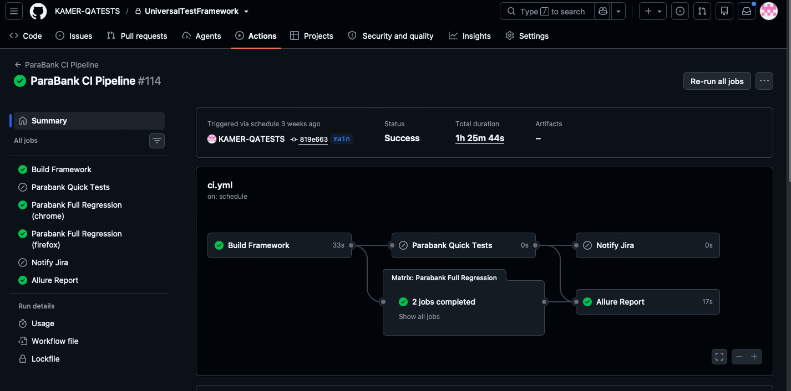
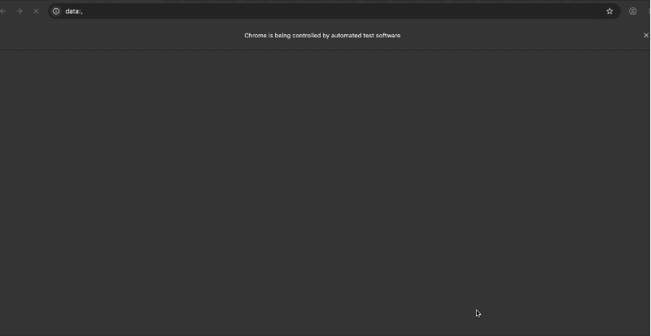

# ParaBank QA Automation Framework

> **Full source code is in a private repository.**  
> Read-only access available on request for interviewers.

---

## What This Project Is

A production-grade test automation framework built from scratch over 18 months,
testing ParaBank — a demo banking application by Parasoft.

Architecture and all design decisions are documented below.

---

## Tech Stack

| Layer | Technology |
|---|---|
| Language | Java 22 |
| Test Framework | TestNG |
| UI Automation | Selenium WebDriver 4 |
| API Testing | REST Assured |
| Build Tool | Maven (multi-module) |
| CI/CD | GitHub Actions + Jenkins |
| Reporting | Allure + ExtentReports |
| Test Management | Jira + Confluence |
| Containerisation | Docker |

---

## Architecture — 4 Maven Modules

```text
pom.xml (parent)
├── core-framework
│   └── (WebDriver, Config, Base classes, Listeners)
├── shared-domain-objects
│   └── (Reusable domain models — Account, Customer, Transaction)
├── shared-resources
│   └── (Config files, Test data)
└── test-projects/parabank-tests
    └── (Full test suite — UI, API, Hybrid, E2E)
```

👉 [Full Architecture Documentation](docs/architecture.md)

-----

## Test Coverage

|Layer       |Count   |Groups                   |
|------------|--------|-------------------------|
|UI Tests    |60+     |smoke, sanity, regression|
|API Tests   |25+     |contract, business       |
|Hybrid Tests|5       |e2e, business            |
|E2E Tests   |3       |canary, regression       |
|**Total**   |**~120**|                         |

-----

## Key Design Decisions

### Application Behaviour Analysis

During testing, discovered that ParaBank’s form login accepts any non-empty
credentials (known demo app behaviour). Adapted test strategy accordingly —
negative login tests use the REST API endpoint which enforces proper validation.

### Contract vs Business Split

Demo server is shared and unstable. Contract tests check API format — safe for CI.
Business tests check financial logic — run locally with controlled data.

### RetryAnalyzer

Retries only environment exceptions (Timeout, StaleElement).
Never retries AssertionError — assertion failures indicate real application
defects, not environment issues.

### Hybrid Testing

API for setup (fast, stable), UI for verification (user-facing correctness).
One test validates the full stack without full E2E cost.

### 4-Layer ConfigManager

System properties → local.properties → environment file → framework defaults.
CI passes values via `-D` flags. Developers override locally. No hardcoded values.

-----

## CI/CD Pipeline



- **Every push:** Build + API smoke tests
- **Every PR:** API + UI smoke (Chrome + Firefox matrix)
- **Weekly:** Full regression (120+ tests, 2 browsers)
- **After main merge:** Allure report → GitHub Pages

-----

## Live Demo



-----

## Framework Capabilities

- Page Object Model + Component Objects
- Data-driven testing (CSV + JSON + TestNG DataProvider)
- Configurable RetryAnalyzer (environment exceptions only)
- Parallel execution support (class-level, ThreadLocal WebDriver)
- Dual reporting: Allure + ExtentReports
- CI/CD ready: GitHub Actions + Jenkins in Docker
- Dockerised local test execution

-----

## Request Full Source Access

This repository is private to protect the work.  
For interview purposes, I can provide:

- A time-limited read-only viewer link (7 days)
- Direct GitHub collaborator access (temporary)

**Contact:** kamerkonak@outlook.com


